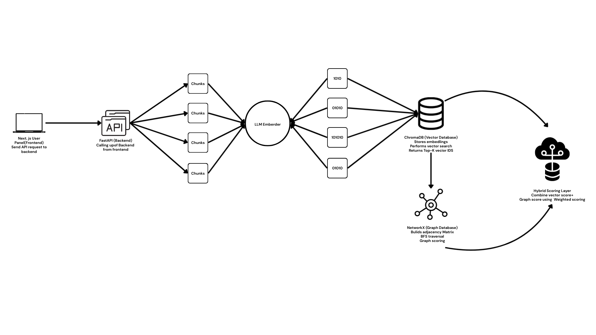
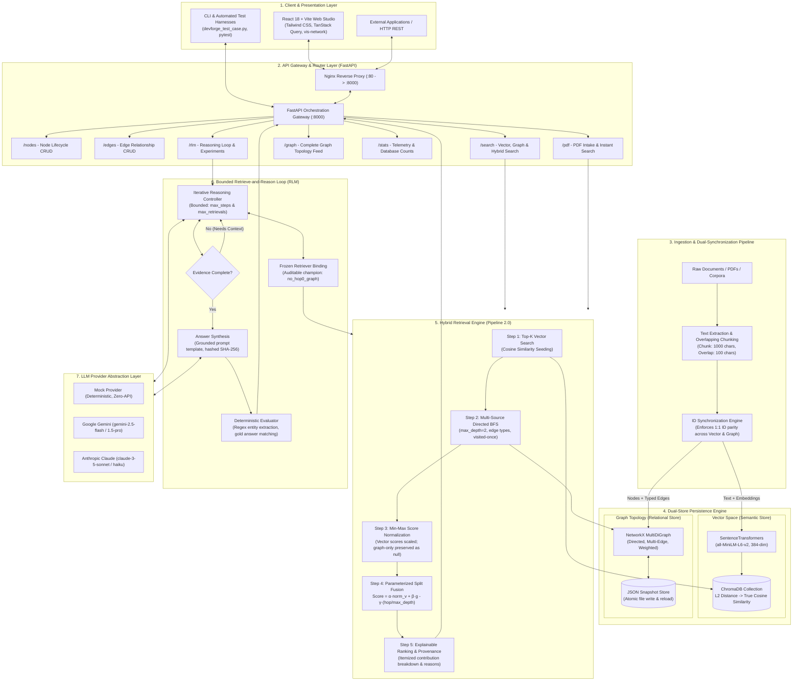

# 🧠 Hybrid RAG & RLM (Retrieve-and-Reason Language Model)

[](https://fastapi.tiangolo.com/)
[](https://react.dev/)
[](https://www.trychroma.com/)
[](https://networkx.org/)
[](https://huggingface.co/sentence-transformers/all-MiniLM-L6-v2)
[](https://www.docker.com/)
[](https://pytest.org/)

A research-grade, production-ready **Hybrid Vector + Knowledge Graph Retrieval-Augmented Generation (RAG)** platform paired with a bounded **Retrieve-and-Reason Loop Model (RLM)**.

By combining unstructured semantic similarity with structured multi-hop relational graph traversals, this system solves the context-fragmentation and multi-hop reasoning failures inherent to pure vector search. It features an explainable hybrid scoring pipeline, rigorous benchmarking harness, fusion ablation studies, a bounded reasoning loop with multi-provider LLM support (Google Gemini, Anthropic Claude, Mock), and an interactive React web studio.

---

## 📑 Table of Contents

- [Complete System Architecture](#-complete-system-architecture)
- [Key Features](#-key-features)
- [Hybrid Retrieval Pipeline 2.0](#-hybrid-retrieval-pipeline-20)
  - [Mathematical Scoring Formulation](#mathematical-scoring-formulation)
  - [Full Explainability & Decomposition](#full-explainability--decomposition)
- [RLM: Retrieve-and-Reason Loop Model](#-rlm-retrieve-and-reason-loop-model)
  - [The Multi-Hop Reasoning Loop](#the-multi-hop-reasoning-loop)
  - [Provider Support & Privacy Guardrails](#provider-support--privacy-guardrails)
  - [Deterministic Evaluation](#deterministic-evaluation)
- [Benchmarking & Fusion Ablation](#-benchmarking--fusion-ablation)
- [Interactive Frontend Studio](#-interactive-frontend-studio)
- [Complete REST API Reference](#-complete-rest-api-reference)
- [Quick Start & Installation](#-quick-start--installation)
  - [Option A: Docker Compose (Recommended)](#option-a-docker-compose-recommended)
  - [Option B: Local Development](#option-b-local-development)
- [Running Benchmarks, Ablations & Tests](#-running-benchmarks-ablations--tests)
- [Project Directory Structure](#-project-directory-structure)

---

## 🏗️ Complete System Architecture

The platform is designed around a **Dual-Store Hybrid Vector + Knowledge Graph Native Architecture** coupled with an auditable, bounded **Retrieve-and-Reason Loop Model (RLM)**.

---

### High-Level Architectural Diagram



---

### End-to-End Component & Data Flow Diagram



---

### Detailed Layer-by-Layer Architectural Breakdown

The system is organized into **8 decoupled, modular architectural layers**, ensuring strict separation of concerns, high maintainability, and end-to-end provenance:

| # | Architectural Layer | Primary Technology | Core Function & Responsibility |
| :-: | :--- | :--- | :--- |
| **1** | **Client & Presentation** | React 18, Vite, Tailwind CSS, TanStack Query | Interactive dashboards, node/edge CRUD modals, search weight tuning, interactive `vis-network` canvas, RLM laboratory, and automated test runners. |
| **2** | **Gateway & Routing** | FastAPI, Uvicorn, Nginx | Central HTTP router, lifespan startup caching (eliminating cold starts), CORS negotiation, error interception, and JSON contract enforcement. |
| **3** | **Ingestion & Sync** | Python, PyPDF, RegEx | Document ingestion, text normalization, overlapping character chunking (1000/100), and ID synchronization across vector and graph engines. |
| **4** | **Semantic Vector Store** | ChromaDB, LangChain, SentenceTransformers | Persistent vector embeddings (`all-MiniLM-L6-v2`), L2 distance to cosine transformation, and top-$K$ semantic candidate retrieval. |
| **5** | **Relational Graph Store** | NetworkX (`MultiDiGraph`), JSON Snapshotter | Directed multi-edge relational graph, edge weights $[0, 1]$, node attributes, multi-hop BFS traversals, and atomic JSON persistence. |
| **6** | **Hybrid Retrieval Engine** | Pipeline 2.0 (Custom Fusion Service) | Multi-source BFS expansion from vector seeds, min-max score normalization, split scoring arithmetic, distance penalties, and explainable audit trails. |
| **7** | **RLM Reasoning Engine** | Bounded Reasoning Loop (`rlm/loop.py`) | Multi-turn Retrieve-and-Reason loop, capped iterations, SHA-256 prompt hashing, and multi-provider execution (Mock, Google Gemini, Claude). |
| **8** | **Deterministic Evaluation** | Benchmark & Evaluation (`rlm/evaluate.py`) | Offline entity-extraction evaluation (procedure/policy/equipment codes), chunk-level recall, latency benchmarking, and token accounting. |

---

#### 1️⃣ Client & Presentation Layer (`Frontend/`)
- **React 18 + Vite**: High-performance Single Page Application (SPA) with lightning-fast Hot Module Replacement (HMR).
- **Tailwind CSS Design System**: Cohesive, modern UI with clear visual hierarchy, accessible contrast ratios, and clean layout patterns.
- **TanStack Query (React Query)**: Optimistic UI updates, automated background cache refetching, and query invalidation on database mutations.
- **`vis-network` Canvas**: Real-time interactive physics-driven visualization of the graph database with zoom, pan, node drag, and edge-weight-dependent line thickness.
- **Integrated Test Runner**: In-browser execution suite executing the full 12 DevForge verification tests with real-time pass/fail indicators.

#### 2️⃣ API Gateway & Orchestration Layer (`app/`)
- **FastAPI Engine**: Fully asynchronous ASGI web gateway exposing strict Pydantic schemas.
- **Lifespan Startup Management**: Preloads the `sentence-transformers` neural model and initializes ChromaDB collections at container boot, completely preventing request-time race conditions and cold-start spikes.
- **Modular Routers**:
  - `nodes.py`: Node creation, inspection, text/metadata updates, and cascading deletion.
  - `edges.py`: Directed relationship creation, weight adjustments, and edge deletion.
  - `search.py`: Vector search, graph BFS search, and Pipeline 2.0 hybrid search.
  - `pdf.py`: Multipart PDF upload, chunking, sequential linking, and immediate query execution.
  - `graph.py`: Complete graph serialization for visualizer rendering.
  - `stats.py`: Real-time telemetry reporting node counts, edge counts, and document totals.
  - `rlm.py`: Multi-step reasoning loops, benchmark datasets, and recorded ablation experiments.
- **Nginx Reverse Proxy**: Fronts the application in production Docker deployments, terminating HTTP, handling SPA client-side routing fallbacks, and proxying `/api/` traffic.

#### 3️⃣ Ingestion & Dual-Synchronization Pipeline (`ingest_data.py`)
- **ID Parity Protocol**: For hybrid retrieval to work, document IDs **must match identically** between vector collections and graph nodes. The ingestion pipeline guarantees that a chunk identified as `chunk_4` in ChromaDB corresponds exactly to node `chunk_4` in NetworkX.
- **Recursive Overlapping Chunking**: Large documents and PDFs are split into 1,000-character fragments with a 100-character sliding overlap window to preserve boundary context.
- **Sequential Passage Linking**: Consecutive chunks within a source document are automatically wired in the graph using directed `next_chunk` edges, enabling natural narrative and procedural traversal.

#### 4️⃣ Semantic Vector Database Layer (`app/vector_db.py`)
- **Embedding Generation**: Local execution of `all-MiniLM-L6-v2` generating 384-dimensional dense semantic vectors. Fast inference with zero external API dependencies.
- **ChromaDB Vector Store**: Local persistent ChromaDB instance with telemetry explicitly disabled for privacy.
- **Distance Conversion**: ChromaDB returns squared L2 distances ($d_{\text{L2}}^2$). The vector service mathematically maps this to true cosine similarity:
  $$\text{Cosine Similarity} = 1 - \frac{d_{\text{L2}}^2}{2}$$
- **Metadata Filtering**: Supports attribute-level filtering during vector search (e.g. `{ "category": "database" }`).

#### 5️⃣ Relational Graph Database Layer (`graph_db/`)
- **NetworkX MultiDiGraph**: Directed multigraph supporting multiple typed edges between the same pair of nodes (e.g., `doc1` $\xrightarrow{\text{references}}$ `doc2` and `doc1` $\xrightarrow{\text{extends}}$ `doc2`).
- **Edge Weight Modeling**: Edges store continuous relationship strengths in the range $[0.0, 1.0]$.
- **Atomic JSON Persistence**: Persists all nodes, edges, attributes, and adjacency lists into an atomic JSON snapshot (`db/graph_data.json`) with automated background sync.
- **Graph Traversal Operations**: Efficient breadth-first search (BFS) algorithms supporting path reconstruction, edge type filtering, and hop-level tracking.

#### 6️⃣ Hybrid Retrieval Engine (`app/service.py`)
- **Seed Retrieval**: Vector search retrieves top-$K$ semantic candidates.
- **Multi-Source BFS Expansion**: Initiates concurrent BFS exploration from all vector seeds up to `max_depth` (default 2), expanding context to neighboring nodes.
- **Min-Max Score Normalization**: Scales raw cosine similarity scores within the query's candidate set. Critically, **graph-only nodes are never assigned fake vector scores**; they retain `null`, preserving mathematical truth.
- **Split Scoring Formulation**:
  - Vector-hit nodes: $\text{Score} = \alpha \cdot \hat{s}_v + \beta \cdot g - \gamma \cdot \left(\frac{\text{hop}}{\text{max\_depth}}\right)$
  - Graph-only nodes: $\text{Score} = \beta \cdot g - \gamma \cdot \left(\frac{\text{hop}}{\text{max\_depth}}\right)$
- **Auditable Provenance**: Every retrieved node returns its complete decomposition, rank, vector rank, graph rank, hop distance, and incoming edge types.

#### 7️⃣ Bounded Retrieve-and-Reason Subsystem (`rlm/`)
- **Multi-Hop Reasoning Controller**: Designed specifically to answer complex questions that single-pass RAG fails to resolve (e.g. "What maintenance procedure fixes the transmission error caused by fault code X?").
- **Strict Bounded Execution**: Both step iterations (`max_steps`) and retrieval operations (`max_retrievals`) are capped to prevent infinite loops and runaway API expenditures.
- **Prompt Template Hashing**: All system prompt templates (`DECIDE_TEMPLATE`, `ANSWER_TEMPLATE`) are hashed via SHA-256 into the execution record. Any prompt adjustment is permanently recorded in benchmark logs.
- **Provider Abstraction**: Unified provider interface supporting `mock` (zero-cost offline testing), `google` (Gemini 2.5 Flash / 1.5 Pro), and `anthropic` (Claude 3.5 Sonnet / Haiku).
- **Corporate Privacy Firewall**: Documents tagged under corporate or personal collections (`production-uploads-v1`) are strictly blocked by runtime guardrails from dispatch to hosted cloud LLMs.

#### 8️⃣ Deterministic Evaluation & Benchmarking (`benchmark.py`, `rlm/evaluate.py`)
- **Scientific Validity Enforcement**: Benchmarks bind directly to corpus digests. If node IDs collide or corpus contents mutate, benchmarks halt rather than generating inaccurate metrics.
- **Deterministic Accuracy Scoring**: Answers are scored without stochastic LLM judges by testing extracted entity sets (e.g., procedure codes `MP-\d{3}`, equipment codes `TX-\d{3}`, policy codes `PL-[A-L]`) against ground-truth labels.
- **Comprehensive Quality Metrics**: Precision@K, Recall@K, MRR (Mean Reciprocal Rank), NDCG@K (Normalized Discounted Cumulative Gain), chunk-level evidence coverage, retrieval latency, and token consumption.

## ✨ Key Features

- **Native Dual-Database Architecture**: Synchronized document IDs across ChromaDB vector space and NetworkX graph topology.
- **Explainable Pipeline 2.0**: Every retrieved document returns an itemized audit trail: vector similarity, normalized vector score, graph connectivity, distance penalty, vector contribution, graph contribution, and traversal hops.
- **Dynamic PDF Pipeline**: Upload any PDF document to automatically extract text, generate overlapping chunks, link sequential passages with `next_chunk` graph edges, compute vector embeddings, and immediately perform hybrid search.
- **Interactive Graph Visualizer**: Physics-driven graph canvas with node inspection, edge weight thickness, drag/zoom/pan, and real-time auto-refresh on mutations.
- **Bounded Retrieve-and-Reason Loop (RLM)**: Iterative evidence-gathering loop that stops as soon as sufficient evidence is found or pre-configured step/retrieval caps are reached.
- **Strict Benchmarking & Fusion Ablation**: Ground-truth datasets (`meridian-transit-v1`, `romeo-and-juliet-summary-v1`) scored against NDCG@5, MRR, Recall@5, Precision@5, and mean latency.
- **Docker Compose Ready**: One-command deployment with Nginx frontend proxying to the FastAPI backend.

---

## 🔬 Hybrid Retrieval Pipeline 2.0

Standard vector search retrieves text fragments with similar vocabulary or semantic embeddings, but struggles with multi-hop relations, structural hierarchies, and domain causality. Pure graph search excels at following structural links, but requires an exact entry point.

**Hybrid Retrieval Pipeline 2.0 combines both**:
1. **Vector Retrieval**: Seeds the search by finding top-$K$ semantically similar nodes via cosine similarity.
2. **Multi-Source Graph Expansion**: Executes a breadth-first search (BFS) up to `max_depth` (default: 2) from all vector seeds, capturing structural context and relational neighbors.
3. **Score Normalization & Fusion**: Fuses scores using a mathematically sound split formula.

### Mathematical Scoring Formulation

For nodes retrieved via vector search:
$$\text{Score}_{\text{unclamped}} = (\alpha \cdot \hat{s}_v) + (\beta \cdot g) - \left(\gamma \cdot \frac{\text{hop}}{\text{max\_depth}}\right)$$

For graph-only nodes discovered during expansion (no fake vector scores):
$$\text{Score}_{\text{unclamped}} = (\beta \cdot g) - \left(\gamma \cdot \frac{\text{hop}}{\text{max\_depth}}\right)$$

The final ranking score is clamped:
$$\text{Final Score} = \max(0.0, \text{Score}_{\text{unclamped}})$$

Where:
- $\alpha$ (`vector_weight`): Relative importance of semantic similarity (default: `0.6`).
- $\beta$ (`graph_weight`): Relative importance of graph relational structure (default: `0.4`).
- $\gamma$ (`path_distance_penalty`): Linear distance penalty per graph hop (default: `0.1`).
- $\hat{s}_v$: Min-max normalized cosine similarity within the vector result set:
  $$\hat{s}_v = \frac{s_v - v_{\min}}{(v_{\max} - v_{\min}) + \epsilon}$$
- $g$: Graph proximity score based on hop distance:
  $$g = \frac{1}{\text{hop} + 1}$$

### Full Explainability & Decomposition

Each result item returns a structured breakdown:

```json
{
  "node_id": "doc1",
  "raw_vector_score": 0.8421,
  "normalized_vector_score": 1.0,
  "graph_score": 1.0,
  "vector_contribution": 0.6,
  "graph_contribution": 0.4,
  "penalty_contribution": 0.0,
  "unclamped_final_score": 1.0,
  "final_score": 1.0,
  "retrieval_sources": ["vector", "graph"],
  "reason": {
    "rank": 1,
    "vector_rank": 1,
    "graph_rank": 1,
    "hop": 0,
    "edge": null,
    "retrieval_method": ["vector", "graph"]
  },
  "text": "Redis caching strategies and architecture..."
}
```

---

## 🤖 RLM: Retrieve-and-Reason Loop Model

The **RLM (Retrieve-and-Reason Loop Model)** subsystem (`rlm/`) introduces a bounded reasoning cycle over a frozen retrieval configuration.

### The Multi-Hop Reasoning Loop

```mermaid
sequenceDiagram
    participant User as Client / UI
    participant Loop as RLM Loop (loop.py)
    participant Retriever as Frozen Hybrid Retriever
    participant LLM as LLM Provider (Gemini / Claude / Mock)

    User->>Loop: POST /rlm/ask (Question, Corpus, Budget)
    Loop->>Retriever: Step 1: Initial Hybrid Retrieval
    Retriever-->>Loop: Top Evidence Chunks
    
    loop Up to max_steps or until DECIDE emits STOP
        Loop->>LLM: DECIDE_TEMPLATE (Question + Evidence Gathered)
        alt Sufficient Evidence
            LLM-->>Loop: Stop decision
        else Needs More Evidence
            LLM-->>Loop: Next targeted search sub-query
            Loop->>Retriever: Step N: Targeted Hybrid Retrieval
            Retriever-->>Loop: Additional Context Chunks
        end
    end

    Loop->>LLM: ANSWER_TEMPLATE (Question + Accumulated Evidence)
    LLM-->>Loop: Final Grounded Answer
    Loop->>User: Structured Response (Answer + Audit Trail + Cost/Tokens)
```

1. **Iteration Bounds**: Every iteration costs retrieval and generation. Iterations (`max_steps`, default 3) and retrieval operations (`max_retrievals`, default 3) are strictly bounded.
2. **Auditability**: All prompt templates are hashed with SHA-256 into the run record. Any template modification is instantly visible in benchmark records.
3. **Frozen Retriever Binding**: The loop reads `experiment_frozen_retrieval_config.json`. If this configuration is missing, the loop refuses to execute, preventing silent unverified retrieval.

### Provider Support & Privacy Guardrails

- **Mock Provider (`mock`)**: Completely offline and deterministic. Ideal for CI/CD, unit testing, and accounting validation without API credentials.
- **Google Provider (`google`)**: Powered by Google GenAI (`gemini-2.5-flash`, `gemini-1.5-pro`).
- **Anthropic Provider (`anthropic`)**: Powered by Anthropic Claude SDK (`claude-3-5-sonnet`, `claude-3-haiku`).
- **Privacy Enforcement**: Corporate/personal corpora (`production-uploads-v1`) are blocked by code guardrails from being dispatched to hosted third-party LLM providers.

### Deterministic Evaluation

The RLM evaluation engine (`rlm/evaluate.py`) tests accuracy without relying on stochastic LLM-as-a-judge:
- **Answer Correctness**: Evaluated against ground-truth regex patterns (e.g., procedure codes `MP-\d{3}`, policy codes `PL-[A-L]`, equipment codes `[A-Z]{2}-\d{1,3}`).
- **Evidence Coverage**: Computes whether the exact ground-truth answer-bearing chunks reached the context window.
- **Resource Metrics**: Tracks wall-clock latency (retrieval vs generation), token consumption (input/output), and step counts.

---

## 📊 Benchmarking & Fusion Ablation

The repository includes a rigorous benchmarking harness adhering to strict scientific validity:
- **Corpus Fingerprinting**: Datasets are bound to corpus SHA-256 digests. If node IDs collide or corpus text changes, benchmarks halt.
- **Propagating Errors**: Retrieval exceptions are never swallowed; failures produce invalid runs rather than misleading zero scores.

### Fusion Ablation Variants

Evaluated on the synthetic multi-hop dataset (`meridian-transit-v1` with 60 labeled queries across single-hop factual, 1-hop cause, and 2-hop causal queries):

| Variant | NDCG@5 | Recall@5 | Precision@5 | MRR | Latency (ms) | Description |
| :--- | :---: | :---: | :---: | :---: | :---: | :--- |
| **Control** | 0.3540 | 0.3750 | 0.0767 | 0.3478 | 11.00 ms | Unmodified Pipeline 2.0 with seed graph credit |
| **`no_hop0_graph` (Frozen)** | **0.4724** | **0.6333** | **0.1400** | **0.4169** | **11.66 ms** | **Hop-0 vector seeds receive no graph credit** |
| **`max_norm`** | 0.3540 | 0.3750 | 0.0767 | 0.3478 | 11.20 ms | Normalizes vector scores via $s / s_{\max}$ |
| **`rrf`** | 0.3120 | 0.3300 | 0.0650 | 0.3010 | 12.10 ms | Reciprocal Rank Fusion ($k=60$) |

### Selection Rule Outcome

The variant `no_hop0_graph` beat the control by **+0.1184 NDCG@5** (well above the 0.05 margin threshold) while preserving 1.0 NDCG on single-hop queries. It was selected and frozen in `experiment_frozen_retrieval_config.json`.

---

## 💻 Interactive Frontend Studio

Built with Vite, React 18, and Tailwind CSS, the UI provides 8 dedicated workspaces:

| Page | Route | Description |
| :--- | :--- | :--- |
| **Dashboard** | `/` | Real-time counts of graph nodes, edges, vector documents, and quick links. |
| **Nodes** | `/nodes` | Table of all nodes with create, view, edit, and delete actions with JSON metadata validation. |
| **Edges** | `/edges` | Relationship manager supporting custom edge types, source/target IDs, and weight sliders. |
| **Search** | `/search` | Vector and Hybrid search with interactive sliders for $\alpha$, $\beta$, and $\gamma$, complete with score decomposition cards. |
| **PDF Upload** | `/pdf` | Drag-and-drop document upload with automatic text extraction, chunking, sequential graph linking, and immediate query execution. |
| **Graph View** | `/graph` | Interactive 2D graph canvas (`vis-network`) with drag, zoom, pan, node detail inspector, and edge weight thickness. |
| **RLM Studio** | `/rlm` | Interactive reasoning laboratory: run multi-step questions, inspect evidence chains, view dataset questions, and examine ablation metrics. |
| **Test Runner** | `/tests` | In-browser compliance test runner executing the 12 DevForge verification cases with instant visual status. |

---

## 🔌 Complete REST API Reference

The FastAPI backend exposes comprehensive CRUD, search, visualization, and reasoning endpoints.

### 1. Node Management

#### Create Node
```http
POST /nodes
Content-Type: application/json

{
  "id": "doc1",
  "text": "Redis caching strategies and memory optimization.",
  "metadata": { "category": "database", "priority": "high" },
  "embedding": null,
  "regen_embedding": true
}
```
**Response (200 OK):**
```json
{
  "status": "created",
  "id": "doc1",
  "embedding_dim": 384
}
```

#### Get Node
```http
GET /nodes/{id}
```
**Response (200 OK):**
```json
{
  "id": "doc1",
  "text": "Redis caching strategies and memory optimization.",
  "metadata": { "category": "database", "priority": "high" },
  "embedding": [0.023, -0.041, 0.015],
  "edges": [
    {
      "edge_id": "e_abc123",
      "target": "doc2",
      "type": "related_to",
      "weight": 0.85
    }
  ]
}
```

#### Update Node
```http
PUT /nodes/{id}
Content-Type: application/json

{
  "text": "Updated Redis caching guide with Redis Cluster details.",
  "metadata": { "category": "database", "version": 2 },
  "regen_embedding": true
}
```

#### Delete Node (Cascades Connected Edges)
```http
DELETE /nodes/{id}
```
**Response (200 OK):**
```json
{
  "status": "deleted",
  "id": "doc1",
  "removed_edges_count": 2
}
```

---

### 2. Edge Management

#### Create Edge
```http
POST /edges
Content-Type: application/json

{
  "source": "doc1",
  "target": "doc2",
  "type": "references",
  "weight": 0.85
}
```
**Response (200 OK):**
```json
{
  "status": "created",
  "edge_id": "edge_f1a2b3",
  "source": "doc1",
  "target": "doc2"
}
```

#### Get Edge
```http
GET /edges/{edge_id}
```

#### Update Edge Weight
```http
PUT /edges/{edge_id}
Content-Type: application/json

{
  "weight": 0.95
}
```

#### Delete Edge
```http
DELETE /edges/{edge_id}
```

---

### 3. Search & Retrieval

#### Vector Search
```http
POST /search/vector
Content-Type: application/json

{
  "query_text": "redis memory optimization",
  "top_k": 5,
  "metadata_filter": { "category": "database" }
}
```

#### Graph Traversal
```http
GET /search/graph?start_id=doc1&depth=2&type_filter=references
```

#### Hybrid Search (Pipeline 2.0)
```http
POST /search/hybrid
Content-Type: application/json

{
  "query_text": "how to optimize redis memory",
  "vector_weight": 0.6,
  "graph_weight": 0.4,
  "top_k": 5,
  "max_depth": 2,
  "path_distance_penalty": 0.1
}
```
**Response (200 OK):**
```json
{
  "query_text": "how to optimize redis memory",
  "vector_weight": 0.6,
  "graph_weight": 0.4,
  "pipeline_version": "2.0",
  "results": [
    {
      "node_id": "doc1",
      "raw_vector_score": 0.8842,
      "normalized_vector_score": 1.0,
      "graph_score": 1.0,
      "vector_contribution": 0.6,
      "graph_contribution": 0.4,
      "penalty_contribution": 0.0,
      "unclamped_final_score": 1.0,
      "final_score": 1.0,
      "retrieval_sources": ["vector", "graph"],
      "reason": {
        "rank": 1,
        "vector_rank": 1,
        "graph_rank": 1,
        "hop": 0,
        "edge": null,
        "retrieval_method": ["vector", "graph"]
      },
      "metadata": { "category": "database" },
      "text": "Redis caching strategies and memory optimization."
    }
  ]
}
```

---

### 4. PDF Ingestion & Graph Endpoints

#### Process PDF and Search
```http
POST /pdf/search
Content-Type: multipart/form-data

file: <binary_pdf_data>
query: "What are the failover procedures?"
```

#### Graph Structure & Statistics
- `GET /graph`: Returns full graph payload (`nodes`, `edges`, `stats`) for `vis-network` visualization.
- `GET /stats`: Returns total node counts, edge counts, and vector store document counts.

---

### 5. RLM (Retrieve-and-Reason) Endpoints

#### Ask RLM
```http
POST /rlm/ask
Content-Type: application/json

{
  "question": "Which maintenance procedure resolves transmission fault TX-440?",
  "provider": "mock",
  "model": null,
  "corpus_id": "meridian-transit-v1",
  "top_k": 5,
  "max_steps": 3,
  "max_retrievals": 3,
  "temperature": 0.0,
  "max_tokens": 512
}
```
**Response (200 OK):**
```json
{
  "question": "Which maintenance procedure resolves transmission fault TX-440?",
  "provider": "mock",
  "model": "mock-deterministic",
  "answer": "Procedure MP-104 resolves TX-440 transmission errors.",
  "evaluative": true,
  "iterations": 2,
  "retrieval_count": 2,
  "evidence": [
    {
      "node_id": "chunk_tx_440",
      "text": "Equipment TX-440 is serviced according to Procedure MP-104.",
      "hop": 0,
      "retrieved_by_vector": true
    }
  ],
  "latency": {
    "total_ms": 14.2,
    "retrieval_ms": 11.5,
    "generation_ms": 2.7
  },
  "answer_evaluation": {
    "gold_answer": "MP-104",
    "exact_match": true,
    "precision": 1.0,
    "recall": 1.0
  }
}
```

#### RLM Status, Datasets & Ablation Results
- `GET /rlm/status`: Checks active providers, API key availability, and frozen configurations.
- `GET /rlm/dataset?corpus_id=meridian-transit-v1`: Fetches benchmark questions and ground-truth answers.
- `GET /rlm/experiments`: Lists recorded experiment run artifacts.
- `GET /rlm/ablation`: Fetches recorded fusion ablation numbers across all variants.

---

## 🚀 Quick Start & Installation

### Prerequisites

- **Python**: Version 3.10, 3.11, or 3.12
- **Poetry**: Python dependency and packaging manager
- **Node.js**: Version 18+ and npm
- **Docker & Docker Compose** (Optional, for containerized run)

### Environment Setup

Create your `.env` file in the project root:

```bash
cp .env.example .env
```

Edit `.env` to supply optional LLM API keys:
```env
GOOGLE_API_KEY=your_google_gemini_key_here
ANTHROPIC_API_KEY=your_anthropic_claude_key_here
GROQ_API_KEY=your_groq_key_here
VITE_API_URL=http://localhost:8000
```
*(Note: You can run vector search, hybrid retrieval, graph traversal, and RLM with the `mock` provider without any API keys).*

---

### Option A: Docker Compose (Recommended)

Run the entire stack (FastAPI Backend + Nginx-served React Frontend + Persistent Volumes) with a single command:

```bash
docker compose up --build
```

- **Frontend UI**: [http://localhost:3000](http://localhost:3000)
- **FastAPI Backend**: [http://localhost:8000](http://localhost:8000)
- **Interactive API Swagger Docs**: [http://localhost:8000/docs](http://localhost:8000/docs)

---

### Option B: Local Development

#### 1. Backend Setup

```bash
# Install Python dependencies via Poetry
poetry install

# Populate databases with initial synced sample data
poetry run python ingest_data.py

# Start the FastAPI server
poetry run uvicorn app.main:app --host 0.0.0.0 --port 8000 --reload
```

The backend is live at `http://localhost:8000`.

#### 2. Frontend Setup

In a new terminal window:

```bash
cd Frontend

# Install node dependencies
npm install

# Start Vite dev server
npm run dev
```

The UI is live at `http://localhost:3000`.

---

## 🧪 Running Benchmarks, Ablations & Tests

### 1. Backend Pytest Compliance Suite
Runs all endpoint assertions and database lifecycle tests:
```bash
poetry run pytest tests/test_api_compliance.py -v
```

### 2. Standalone DevForge Test Runner
Executes the original 12 compliance cases sequentially:
```bash
poetry run python devforge_test_case.py
```

### 3. Production Retrieval Benchmark
Evaluates the hybrid retrieval engine against ground truth with strict verification:
```bash
# Benchmark on default synthetic corpus
poetry run python benchmark.py

# Benchmark on Romeo & Juliet corpus
BENCHMARK_CORPUS_ID=romeo-and-juliet-summary-v1 poetry run python benchmark.py
```

### 4. Fusion Ablation Experiment
Scores all 4 fusion mechanisms across query categories:
```bash
poetry run python experiments/fusion_ablation.py
```

### 5. Freeze Retrieval Configuration
Applies the formal programmatic selection rules to lock the champion retriever:
```bash
poetry run python experiments/freeze_retrieval_config.py
```

### 6. End-to-End RLM Evaluation
Runs the Retrieve-and-Reason loop across the benchmark dataset:
```bash
# Run with fast deterministic mock provider (5 queries)
poetry run python -m rlm.evaluate --provider mock --limit 5

# Run full evaluation with Google Gemini
poetry run python -m rlm.evaluate --provider google --model gemini-2.5-flash
```

---

## 📁 Project Directory Structure

```text
hybrid-rag-and-rlm/
├── app/                                 # FastAPI Backend Application
│   ├── main.py                          # FastAPI entry point, CORS, lifespan
│   ├── dependencies.py                  # Service singleton dependency provider
│   ├── models.py                        # Pydantic schemas (Pipeline 2.0 & RLM)
│   ├── service.py                       # Core HybridRetrievalService business logic
│   ├── vector_db.py                     # ChromaDB wrapper with LangChain
│   └── routers/                         # API Endpoints
│       ├── nodes.py                     # Node CRUD (/nodes)
│       ├── edges.py                     # Edge CRUD (/edges)
│       ├── search.py                    # Vector, Graph, Hybrid Search (/search)
│       ├── pdf.py                       # PDF Ingestion & Search (/pdf)
│       ├── graph.py                     # Full graph visualization data (/graph)
│       ├── stats.py                     # System metrics (/stats)
│       └── rlm.py                       # Reasoning loop & experiments (/rlm)
├── rlm/                                 # Retrieve-and-Reason Subsystem
│   ├── loop.py                          # Bounded retrieve-and-reason loop
│   ├── evaluate.py                      # Deterministic accuracy & coverage evaluator
│   ├── providers.py                     # LLM abstraction (Google, Anthropic, Mock)
│   └── verify_models.py                 # Live API key & model capability checker
├── experiments/                         # Research & Experimentation Harness
│   ├── fusion_ablation.py               # Fusion formula ablation experiments
│   └── freeze_retrieval_config.py       # Programmatic frozen config selection
├── graph_db/                            # NetworkX Graph Database Module
│   ├── graph_db.py                      # MultiDiGraph CRUD & BFS implementation
│   └── models.py                        # Graph data transfer objects
├── Frontend/                            # Modern React 18 + Vite Web Application
│   ├── src/
│   │   ├── pages/                       # UI Pages
│   │   │   ├── Dashboard.tsx            # System overview & stats
│   │   │   ├── Nodes.tsx                # Node management & JSON editor
│   │   │   ├── Edges.tsx                # Relationship management & weights
│   │   │   ├── Search.tsx               # Hybrid search with live weight sliders
│   │   │   ├── PDFUpload.tsx            # PDF drag-and-drop & instant indexing
│   │   │   ├── GraphView.tsx            # Interactive vis-network canvas
│   │   │   ├── RLM.tsx                  # Reasoning laboratory & ablation viewer
│   │   │   └── TestRunner.tsx           # In-browser compliance test suite
│   │   ├── components/Layout.tsx        # Navigation sidebar & header
│   │   ├── services/api.ts              # Axios client with complete TypeScript types
│   │   ├── App.tsx                      # Client-side routing
│   │   └── index.css                    # Tailwind CSS design system
│   ├── package.json
│   └── vite.config.ts
├── tests/                               # Automated Test Suites
│   └── test_api_compliance.py          # Pytest API compliance test suite
├── benchmark.py                         # Production retrieval benchmark harness
├── benchmark_dataset.json               # Ground truth labeled relevance dataset
├── devforge_test_case.py                # Standalone test runner
├── ingest_data.py                       # Unified Vector + Graph ingestion script
├── experiment_frozen_retrieval_config.json # Auditable champion configuration
├── Dockerfile.backend                   # Backend container definition
├── Dockerfile.frontend                  # Frontend multi-stage build (Nginx)
├── docker-compose.yml                   # Unified Docker Compose orchestrator
├── nginx.conf                           # Nginx reverse proxy configuration
├── pyproject.toml                       # Poetry dependencies & project metadata
└── README.md                            # Complete Project Documentation
```

---

## 📜 License

This project is open-source and available under the [MIT License](LICENSE).
