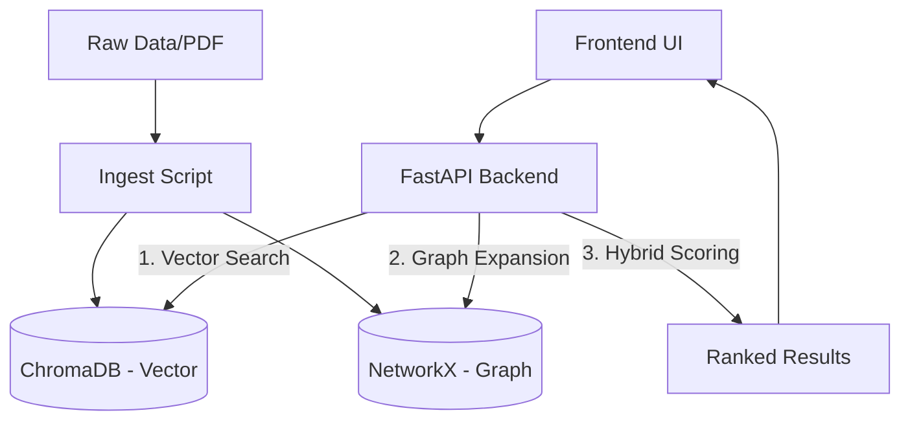

# 🌊 Project Workflow: Hybrid Vector + Graph Retrieval System

This document outlines the end-to-end workflow of the Hybrid Retrieval System, from data ingestion to user search.

---

## 🏗️ 1. High-Level Architecture

The system operates on a dual-database strategy to provide superior RAG (Retrieval-Augmented Generation) results.



1.  **ChromaDB**: Handles semantic similarity search (unstructured).
2.  **NetworkX**: Handles relational and structural reasoning (structured).
3.  **FastAPI**: Orchestrates the hybrid retrieval logic.

---

## 📥 2. Data Ingestion Workflow

Data must be synchronized between both databases to ensure IDs match, which is critical for the hybrid scoring algorithm.

### Ingestion Protocol (`ingest_data.py`)
- **ID Generation**: Unique IDs (e.g., `chunk_1`) are assigned to each text fragment.
- **Vector Storage**: Text + Metadata + ID are sent to ChromaDB.
- **Graph Storage**: Nodes are created in NetworkX using the **exact same ID**.
- **Relationship Mapping**: Edges (e.g., `next`, `mentions`, `related_to`) are created between nodes to form the knowledge graph.

---

## 🔌 3. API Surface & Backend Flow

The backend exposes RESTful endpoints for all operations.

| Feature | Endpoint | Description |
| :--- | :--- | :--- |
| **Hybrid Search** | `POST /search/hybrid` | The core search logic combining Vector + Graph. |
| **Node CRUD** | `GET/POST/PUT/DELETE /nodes` | Manage individual content chunks. |
| **Edge CRUD** | `GET/POST/PUT/DELETE /edges` | Manage relationships between chunks. |
| **PDF Processing** | `POST /pdf/search` | Upload a PDF, chunk it, and search immediately. |

### Hybrid Search Logic Steps:
1.  **Vector Retrieval**: Fetch top-K results based on cosine similarity.
2.  **Graph Expansion**: For each vector result, find nearby nodes in the graph (neighbors).
3.  **Scoring**: `Final Score = (Vector Similarity * Weight) + (Graph Connectivity * Weight)`.
4.  **Ranking**: Sorted results are returned to the user.

---

## 💻 4. Frontend Interaction Workflow

The frontend is a modern React/Vite application that communicates with the API.

1.  **Initialization**: On load, it checks backend connectivity.
2.  **Search Workflow**:
    - User enters query in `Search.tsx`.
    - UI calls `POST /search/hybrid`.
    - Backend returns IDs and Scores.
    - UI fetches full node details for each ID to display content.
3.  **Management**: `Nodes.tsx` and `Edges.tsx` provide forms to modify the underlying data structured dynamically.

---

## 🛠️ 5. Developer Workflow (How to Run)

### Backend Setup
```bash
# Install dependencies
poetry install
# Start the FastAPI server
poetry run uvicorn app.main:app --reload
```

### Initial Data Load
```bash
# Clear and repopulate DBs with sample data
python ingest_data.py
```

### Frontend Setup
```bash
cd Frontend
npm install
npm run dev
```

### Testing
```bash
# Run backend test suite
pytest
# Or use the UI Test Runner (Frontend/src/pages/TestRunner.tsx)
```

---

## 📊 Summary of Flow
1. **Prepare**: Data is chunked and synced to Vector + Graph DBs.
2. **Search**: Queries are processed semantically AND relationally.
3. **Analyze**: Results include hybrid scores showing "why" a result was chosen.
4. **Refine**: Users can add edges in the UI to manually "boost" certain relationships for future searches.
